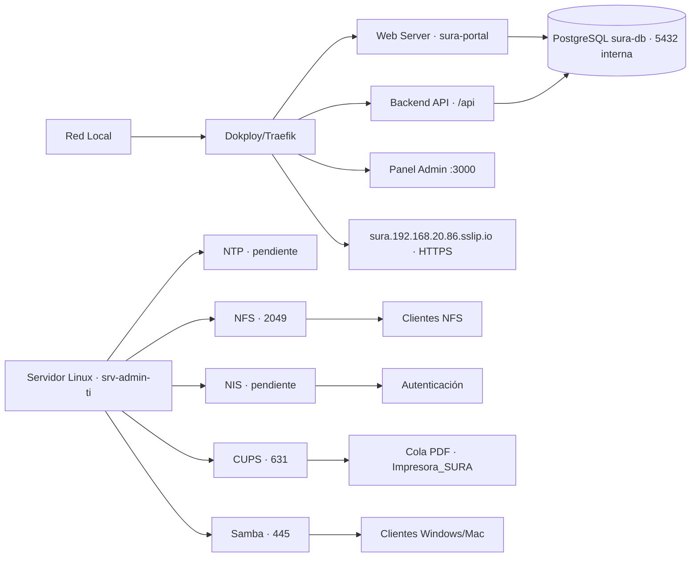

# Análisis y diseño de infraestructura TI — SURA EPS

> **Documento de análisis — Entregable 1 (Semana 1)**  
> **Empresa:** SURA EPS (caso de estudio académico)  
> **Área:** Tecnología de la Información / Infraestructura y Operaciones  
> **Rol:** Equipo de infraestructura TI contratado por la organización  
> **Plataforma propuesta:** Dokploy (PaaS) sobre Ubuntu Server + servicios Linux tradicionales  
> **Versión:** 1.0 · **Estado:** Vigente

---

## 1. Contexto y alcance

El director de TI de SURA EPS solicitó diseñar e implementar la infraestructura de servicios de la organización sobre un servidor local, con el objetivo de **centralizar la gestión de servicios web, archivos, impresión, sincronización de tiempo, autenticación de usuarios y acceso compartido**.

La propuesta combina dos enfoques complementarios:

- **Dokploy (PaaS)** sobre una máquina virtual Ubuntu Server: despliegue de aplicaciones web en contenedores, proxy inverso con Traefik, terminación TLS y base de datos gestionada.
- **Servicios Linux tradicionales** en el servidor: NTP, NFS, NIS, CUPS y Samba, que cubren necesidades de red local que un PaaS no resuelve por sí solo.

El análisis se apoya en los procedimientos documentados por el equipo en `codigo/dokploy/dokploy.md`, `codigo/nfs/nfs.md`, `codigo/cups/cups.md` y `codigo/samba/samba.md`. Los servicios **NTP y NIS se incluyen en el diseño, pero su implementación está pendiente** (ver §6).

---

## 2. Justificación de los servicios propuestos

### 2.1 Máquina virtual y Dokploy (infraestructura base)

SURA EPS necesita un único punto de administración para publicar aplicaciones internas sin depender de configuraciones manuales por aplicación. Dokploy aporta Docker + Docker Swarm, Traefik como proxy inverso y un panel web para gestionar proyectos, dominios y bases de datos.

La VM se dimensionó con **2 vCPU, 4 GB de RAM y 40 GB de disco**, cumpliendo el mínimo de la guía. El disco se configuró **sin LVM** para que Docker disponga de la capacidad total para imágenes y volúmenes, y la red en **modo puente** para que el servidor sea alcanzable desde la LAN con una IP fija. El panel queda en `http://192.168.20.86:3000`.

### 2.2 Servicio Web — portal institucional

El criterio de la guía exige un sitio institucional accesible por HTTPS con contenido relevante. El equipo implementó el **Portal interno de servicios de TI** (`sura-portal`), una aplicación Node.js + Express desplegada por Dokploy desde el repositorio `https://github.com/optitudes/sura_admin_ti.git` (Build Path `/codigo/dokploy/app`, tipo Dockerfile).

El portal satisface el criterio porque:

- Muestra el estado real del despliegue (contenedor, versión de Node y de PostgreSQL).
- Lee desde PostgreSQL las **sedes** y los **servicios de infraestructura** del proyecto (NTP, NIS, NFS, CUPS, Samba, Web y BD), es decir, contenido relevante para la organización.
- Permite **registrar incidentes de TI** sin solicitar credenciales ni datos personales.
- Expone `/health` para verificar la conexión a la base de datos.
- Incluye una franja que aclara que es un proyecto académico y no un sitio oficial de SURA EPS.

> No se instaló Nginx/Apache de forma tradicional: la terminación HTTP y el enrutado los realiza **Traefik v3**, integrado en Dokploy. Esto cumple el requerimiento funcional de "web accesible vía HTTPS" con una arquitectura basada en contenedores.

### 2.3 Base de datos PostgreSQL

El portal necesita persistencia para sedes, servicios e incidentes. Se desplegó `sura-db` con la imagen `postgres:16`, base de datos `sura` y usuario `sura_app`. El servicio **no expone ningún puerto hacia la LAN**: solo es alcanzable por la red interna de Docker mediante la *Internal Connection URL* inyectada en la variable de entorno `DATABASE_URL`. Así se evita exponer credenciales y se simplifica el despliegue.

### 2.4 NTP — sincronización horaria *(pendiente)*

La correlación de logs, la trazabilidad de incidentes y la validez de certificados requieren que todos los equipos compartan la misma hora. Se propone un servidor NTP en el puerto **123/UDP** como referencia de la red, con los clientes apuntando a él. **Estado: pendiente de implementar**; no existe aún guía de instalación ni evidencia en `capturas/`.

### 2.5 NFS — archivos compartidos para estaciones Linux

SURA EPS gestiona dos volúmenes de negocio con propietarios y permisos diferenciados:

| Volumen | Ruta del servidor | Grupo | Usuario | Uso empresarial |
|---------|-------------------|-------|---------|-----------------|
| Afiliaciones | `/srv/nfs/afiliaciones` | `grp_afiliaciones` (GID 2001) | `atencion.afiliado` (UID 2001) | Atención al Afiliado |
| Autorizaciones | `/srv/nfs/autorizaciones` | `grp_autorizaciones` (GID 2002) | `autorizaciones` (UID 2002) | Autorizaciones y Servicios Médicos |

Se usan **UID/GID fijos** para que la propiedad de los archivos sea coherente entre servidor y clientes, y permisos `770` para que solo el dueño y el grupo accedan. Las exportaciones emplean `rw,sync,no_subtree_check,root_squash`, de modo que `root` remoto no obtiene privilegios sobre los datos. El montaje persistente usa `_netdev` y `x-systemd.automount` para no bloquear el arranque si el servidor no responde.

### 2.6 NIS — autenticación centralizada *(pendiente)*

La organización requiere un directorio de usuarios centralizado para que las estaciones Linux compartan cuentas y eviten la proliferación de usuarios locales. Se propone NIS como servicio de autenticación centralizada, integrado con la política de UID/GID ya definida para NFS. **Estado: pendiente de implementar**; no existe aún guía de instalación ni evidencia en `capturas/`.

### 2.7 CUPS — impresión centralizada

La impresión distribuida obligaría a instalar controladores en cada estación y dificultaría la trazabilidad de los trabajos. Se desplegó CUPS en el servidor con la cola virtual **`Impresora_SURA`** (`/printers/Impresora_SURA`), administrada por el grupo `lpadmin`.

El servicio genera comprobantes en PDF mediante `printer-driver-cups-pdf` y centraliza los PPD en el servidor. La administración se hace por `https://${ip del servidor cups}:631/admin` con cifrado TLS, y los clientes-macos se vinculan por IPP/Bonjour. Así se evita la instalación manual de drivers y se dispone de un registro unificado de trabajos.

### 2.8 Samba — acceso compartido desde Windows y Mac

La red de SURA EPS es heterogénea: además de estaciones Linux existen equipos macOS y Windows. Samba (SMB/CIFS) expone el recurso **`//<IP_SERVIDOR>/sura`** sobre `/srv/samba/sura`, con:

- Acceso restringido al grupo del sistema `@sambausers`.
- Credenciales independientes en la base TDB (`passdb.tdb`), desacopladas de `/etc/shadow`.
- Bit **SGID (2775)** en el directorio para heredar el grupo `sambausers` en todos los archivos creados, manteniendo permisos colaborativos `0664` (archivos) y `0775` (directorios) sin intervención manual.

### 2.9 DNS y TLS — acceso seguro por nombre

Para publicar el portal sin comprar un dominio se usa **`sura.192.168.20.86.sslip.io`**, un dominio gratuito que resuelve cualquier nombre con una IP incrustada hacia esa IP. Traefik gestiona el certificado: al tratarse de una IP privada, Let's Encrypt no puede validarla, por lo que se usa el certificado propio de Traefik (*TRAEFIK DEFAULT CERT*). La conexión va cifrada con TLS y, en un entorno de producción con IP pública, bastaría con cambiar el *Certificate Provider* a **Let's Encrypt**.

---

## 3. Tabla de requisitos de red y servicios

Los marcadores `${...}` y `<...>` son **placeholders** que deben reemplazarse por los valores reales del entorno antes de ejecutar cualquier comando (ver §5).

| # | Servicio | IP / destino | Puerto(s) | Protocolo | Tipo de servicio | Criterio de éxito | Estado |
|---|----------|--------------|-----------|-----------|------------------|-------------------|--------|
| 1 | Dokploy (panel) | `192.168.20.86` | 3000 | HTTP | Panel de administración PaaS | Panel accesible y cuenta de administrador creada | Implementado |
| 2 | Traefik (proxy inverso) | `192.168.20.86` | 80, 443 | HTTP / HTTPS (TLS) | Proxy inverso y gestión de certificados | Dominio enrutado al contenedor correcto | Implementado |
| 3 | Web — portal institucional | `sura.192.168.20.86.sslip.io` | 443 | HTTPS | Sitio web interno (Node.js + Express) | Portal cargado por HTTPS con "Base de datos conectada" | Implementado |
| 4 | PostgreSQL `sura-db` | red interna de Docker (`<nombre-interno>`) | 5432 (interno) | TCP | Base de datos gestionada | `Deployment completed successfully!` y `/health` → `{"status":"ok","db":"conectada"}` | Implementado |
| 5 | NTP | *pendiente de definir* | 123 | UDP | Sincronización horaria | Clientes sincronizan con el servidor | **Pendiente** |
| 6 | NFS | `${ip del servidor nfs}` (ej. `192.168.1.6` en `fstab`) | 2049 | TCP / UDP | Compartición de archivos para Linux | `/srv/nfs/afiliaciones` montado en cliente y escritura permitida | Implementado |
| 7 | NIS | *pendiente de definir* | 111 (portmap) + puertos RPC | RPC sobre UDP/TCP | Autenticación centralizada | Clientes se autentican con NIS | **Pendiente** |
| 8 | CUPS | `${ip del servidor cups}` (ej. `192.168.43.8`) | 631 | TCP (IPP/HTTPS) · UDP (descubrimiento) | Servidor de impresión | `Impresora_SURA` compartida, cola con trabajos `completed` | Implementado |
| 9 | Samba | `<IP_SERVIDOR>` | 139, 445 (TCP) · 137, 138 (UDP) | SMB/CIFS · NetBIOS | Compartición de archivos multiplataforma | `smb://<IP_SERVIDOR>/sura` accesible con lectura/escritura | Implementado |
| 10 | DNS dinámico | `sslip.io` | 53 | DNS | Resolución de nombre sin dominio propio | El dominio resuelve a la IP del servidor | Implementado |

---

## 4. Diagrama de arquitectura

**Leyenda:** los nodos `NTP · pendiente` y `NIS · pendiente` forman parte del diseño pero aún no están desplegados. El grafo base se conserva también en `diagrama.md`, y cada servicio dispone de su propio diagrama en `codigo/<servicio>/diagrama-<servicio>.md`.

---

## 5. Convención de direccionamiento

Las guías originales utilizaron marcadores distintos según el servicio. Para no alterar los procedimientos normativos se conservan **literalmente**:

| Marcador | Significado | Guía de origen |
|----------|-------------|----------------|
| `192.168.20.86/24` | IP fija real del entorno de pruebas (VM `dokploy-sura`, gateway `192.168.20.1`) | `codigo/dokploy/dokploy.md` |
| `${ip del usuario}` | IP del cliente autorizado en `/etc/exports` | `codigo/nfs/nfs.md` |
| `${ip del servidor nfs}` | IP del servidor NFS (ej. `192.168.1.6` en `fstab`) | `codigo/nfs/nfs.md` |
| `${ip del servidor cups}` | IP del servidor CUPS (ej. `192.168.43.8`) | `codigo/cups/cups.md` |
| `<IP_SERVIDOR>` | IP del servidor Samba | `codigo/samba/samba.md` |

> **Regla:** no ejecutar comandos con estos marcadores sin reemplazarlos previamente por los valores de la red de SURA EPS.

---

## 6. Estado general de los entregables

| Entregable | Semana | Estado | Evidencia |
|------------|--------|--------|-----------|
| 1. Análisis y diseño | 1 | Este documento + diagramas por servicio | `analisis.md`, `codigo/*/diagrama-*.md` |
| 2. Infraestructura base (VM, NTP, DNS, SSL) | 2 | Parcial: VM, DNS y SSL implementados; **NTP pendiente** | `capturas/dokploy/` |
| 3. Servicios de infraestructura | 3 | Parcial: Web, NFS, CUPS, Samba y BD implementados; **NIS pendiente** | `capturas/dokploy/`, `capturas/nfs/`, `capturas/cups/`, `capturas/samba/` |
| 4. Documentación y presentación | 4 | Este documento | `documentacion.md` |
