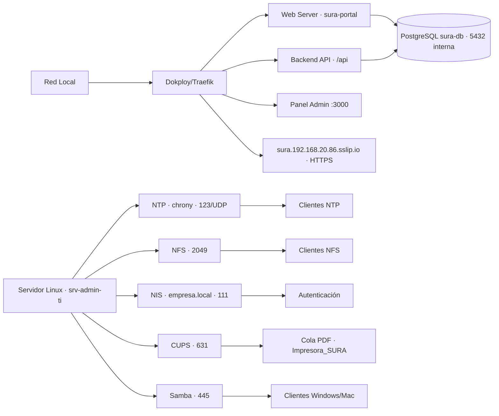

# Análisis y diseño de infraestructura TI — SURA EPS

> **Documento de análisis — Entregable 1 (Semana 1)**  
> **Empresa:** SURA EPS (caso de estudio académico)  
> **Área:** Tecnología de la Información / Infraestructura y Operaciones  
> **Rol:** Equipo de infraestructura TI contratado por la organización  
> **Plataforma propuesta:** Dokploy (PaaS) sobre Ubuntu Server + servicios Linux tradicionales  
> **Versión:** 1.1 · **Estado:** Vigente

---

## 1. Contexto y alcance

El director de TI de SURA EPS solicitó diseñar e implementar la infraestructura de servicios de la organización sobre un servidor local, con el objetivo de **centralizar la gestión de servicios web, archivos, impresión, sincronización de tiempo, autenticación de usuarios y acceso compartido**.

La propuesta combina dos enfoques complementarios:

- **Dokploy (PaaS)** sobre una máquina virtual Ubuntu Server: despliegue de aplicaciones web en contenedores, proxy inverso con Traefik, terminación TLS y base de datos gestionada.
- **Servicios Linux tradicionales** en el servidor: NTP, NFS, NIS, CUPS y Samba, que cubren necesidades de red local que un PaaS no resuelve por sí solo.

El análisis se apoya en los procedimientos documentados por el equipo en `codigo/dokploy/dokploy.md`, `codigo/Ntp/ntp.md`, `codigo/nfs/nfs.md`, `codigo/Nis/nis.md`, `codigo/cups/cups.md`, `codigo/samba/samba.md` y `codigo/red/red.md`. **Los siete servicios de la guía están implementados y tienen evidencia en `capturas/`** (ver §6).

### 1.1 Entorno de laboratorio

El diseño propone un único servidor Linux para los servicios tradicionales y una VM con Dokploy. Para el proyecto, cada integrante implementó y probó su servicio en su propio laboratorio, con la misma configuración que se aplicaría en el servidor de la empresa:

| Servicio | Equipo | Plataforma | Sistema operativo | IP | Responsable |
|----------|--------|------------|-------------------|----|-------------|
| Dokploy, web y base de datos | `dokploy-sura` | VMware Workstation Pro (modo puente) | Ubuntu Server 24.04.5 LTS | `192.168.20.86` | Derek Rodríguez Rodríguez |
| NTP y NIS | `ProyectoFinal` (servidor) y `cliente` | Máquinas virtuales | Ubuntu Server 22.04 LTS | `192.168.1.200` / `192.168.1.201` | Sara María Otero Echeverry |
| NFS | `srvarchivos-armenia` (servidor) y cliente Linux | Equipo Debian | Debian | `192.168.1.6` (cliente `192.168.1.4`) | Juan Sebastián Rojas García |
| CUPS y Samba | `srv-admin-ti` | UTM sobre Apple Silicon M4 (modo puente) | Ubuntu Server 24.04 LTS | `192.168.43.8` | Sara Juliana Faustino Trujillo |

**Decisiones y diferencias con la guía:**

- La VM de Dokploy cumple todos los requisitos de la guía: VMware, Ubuntu Server LTS, 2 vCPU, 4 GB de RAM, 40 GB de disco, modo puente e IP fija.
- CUPS y Samba se probaron en **UTM** porque es el hipervisor disponible en el equipo Mac (Apple Silicon) de la integrante; la VM usa Ubuntu Server 24.04 LTS, 2 vCPU, 4 GB de RAM, 40 GB de disco y red en modo puente.
- El servidor NFS de pruebas corre sobre **Debian**. Ubuntu deriva de Debian y usa los mismos paquetes (`nfs-kernel-server`, `nfs-common`), así que el procedimiento es idéntico en Ubuntu Server.
- **En producción** los servicios NTP, NFS, NIS, CUPS y Samba se consolidarían en un único servidor Ubuntu Server (`srv-admin-ti`), como muestra el diagrama de §4. Las guías usan marcadores de IP (§5) para poder repetirlas en ese servidor sin cambios.

---

## 2. Justificación de los servicios propuestos

### 2.1 Máquina virtual y Dokploy (infraestructura base)

SURA EPS necesita un único punto de administración para publicar aplicaciones internas sin depender de configuraciones manuales por aplicación. Dokploy aporta Docker + Docker Swarm, Traefik como proxy inverso y un panel web para gestionar proyectos, dominios y bases de datos.

La VM se dimensionó con **2 vCPU, 4 GB de RAM y 40 GB de disco**, cumpliendo el mínimo de la guía. El disco se configuró **sin LVM** para que Docker disponga de la capacidad total para imágenes y volúmenes, y la red en **modo puente** para que el servidor sea alcanzable desde la LAN con una IP fija. El panel queda en `http://192.168.20.86:3000`.

### 2.2 Servicio Web — portal institucional

El criterio de la guía exige un sitio institucional accesible por HTTPS con contenido relevante. El equipo implementó el **Portal interno de servicios de TI** (`sura-portal`), una aplicación Node.js + Express desplegada por Dokploy desde el repositorio `https://github.com/optitudes/sura_admin_ti.git` (Build Path `/codigo/dokploy/app`, tipo Dockerfile).

El portal satisface el criterio porque:

- Muestra el estado real del despliegue (contenedor, versión de Node y de PostgreSQL).
- Lee desde PostgreSQL las **sedes** y los **servicios de infraestructura** del proyecto (NTP, NIS, NFS, CUPS, Samba, Web y BD), es decir, contenido relevante para la organización.
- Permite **registrar incidentes de TI** sin solicitar credenciales ni datos personales.
- Expone `/health` para verificar la conexión a la base de datos.
- Incluye una franja que aclara que es un proyecto académico y no un sitio oficial de SURA EPS.

> No se instaló Nginx/Apache de forma tradicional: la terminación HTTP y el enrutado los realiza **Traefik v3**, integrado en Dokploy. Esto cumple el requerimiento funcional de "web accesible vía HTTPS" con una arquitectura basada en contenedores.

### 2.3 Base de datos PostgreSQL

El portal necesita persistencia para sedes, servicios e incidentes. Se desplegó `sura-db` con la imagen `postgres:16`, base de datos `sura` y usuario `sura_app`. El servicio **no expone ningún puerto hacia la LAN**: solo es alcanzable por la red interna de Docker mediante la *Internal Connection URL* inyectada en la variable de entorno `DATABASE_URL`. Así se evita exponer credenciales y se simplifica el despliegue.

### 2.4 NTP — sincronización horaria

La correlación de logs, la trazabilidad de incidentes y la validez de los certificados TLS requieren que todos los equipos compartan la misma hora. Se implementó un servidor de tiempo con **chrony** en `ProyectoFinal` (`192.168.1.200`), puerto **123/UDP**:

- Se sincroniza con los servidores públicos de `pool.ntp.org` y sirve la hora a la red con `allow 192.168.1.0/24`.
- `local stratum 10` mantiene la hora de la red aunque se pierda la conexión a internet.
- Se eligió chrony porque es una implementación moderna de NTP incluida en Ubuntu, corrige rápido la hora tras reinicios o desajustes y permite actuar como servidor con una sola directiva. Al instalarlo, Ubuntu retira `systemd-timesyncd` para que no haya dos servicios de hora.

El cliente (`192.168.1.201`) usa el servidor como única fuente y, en la prueba de desajuste, corrigió la fecha de `2026-01-01` a la hora real. Guía: `codigo/Ntp/ntp.md`.

### 2.5 NFS — archivos compartidos para estaciones Linux

SURA EPS gestiona dos volúmenes de negocio con propietarios y permisos diferenciados:

| Volumen | Ruta del servidor | Grupo | Usuario | Uso empresarial |
|---------|-------------------|-------|---------|-----------------|
| Afiliaciones | `/srv/nfs/afiliaciones` | `grp_afiliaciones` (GID 2001) | `atencion.afiliado` (UID 2001) | Atención al Afiliado |
| Autorizaciones | `/srv/nfs/autorizaciones` | `grp_autorizaciones` (GID 2002) | `autorizaciones` (UID 2002) | Autorizaciones y Servicios Médicos |

El servidor de pruebas es `srvarchivos-armenia` (`192.168.1.6`), que exporta los volúmenes al cliente `192.168.1.4`. Se usan **UID/GID fijos** para que la propiedad de los archivos sea coherente entre servidor y clientes, y permisos `770` para que solo el dueño y el grupo accedan. Las exportaciones emplean `rw,sync,no_subtree_check,root_squash`, de modo que `root` remoto no obtiene privilegios sobre los datos. El montaje persistente usa `_netdev` y `x-systemd.automount` para no bloquear el arranque si el servidor no responde.

### 2.6 NIS — autenticación centralizada

La organización requiere un directorio de usuarios centralizado para que las estaciones Linux compartan cuentas y no se multipliquen los usuarios locales. Se implementó un **servidor NIS maestro** en `ProyectoFinal` (`192.168.1.200`) con el dominio **`empresa.local`**:

- Las cuentas se crean una sola vez en el servidor y se publican como mapas NIS (`passwd`, `group`, `shadow`).
- `MINUID=1001` y `MINGID=1001` evitan publicar la cuenta local de administración (UID 1000).
- `ypserv.securenets` restringe las consultas al propio servidor y a la red `192.168.1.0/24`.
- En el cliente, `nsswitch.conf` consulta NIS y `pam_mkhomedir` crea el directorio personal en el primer inicio de sesión.

Resultado: `usuario1`, que no existe en el cliente, inició sesión con la contraseña definida en el servidor. En la consolidación, los usuarios de NFS (UID/GID 2001 y 2002) también se publicarían por NIS, de modo que la identidad sea la misma en todas las estaciones.

**Limitación conocida:** NIS envía la información de cuentas sin cifrar. Se usa solo en la red local de confianza; la evolución recomendada es LDAP o FreeIPA. Guía: `codigo/Nis/nis.md`.

### 2.7 CUPS — impresión centralizada

La impresión distribuida obligaría a instalar controladores en cada estación y dificultaría la trazabilidad de los trabajos. Se desplegó CUPS en el servidor `srv-admin-ti` (`192.168.43.8`) con la cola virtual **`Impresora_SURA`** (`/printers/Impresora_SURA`), administrada por el grupo `lpadmin`.

El servicio genera comprobantes en PDF mediante `printer-driver-cups-pdf` y centraliza los PPD en el servidor. La administración se hace por `https://${ip del servidor cups}:631/admin` con cifrado TLS, y los clientes-macos se vinculan por IPP/Bonjour. Así se evita la instalación manual de drivers y se dispone de un registro unificado de trabajos.

### 2.8 Samba — acceso compartido desde Windows y Mac

La red de SURA EPS es heterogénea: además de estaciones Linux existen equipos macOS y Windows. Samba (SMB/CIFS) expone el recurso **`//<IP_SERVIDOR>/sura`** sobre `/srv/samba/sura`, con:

- Acceso restringido al grupo del sistema `@sambausers`.
- Credenciales independientes en la base TDB (`passdb.tdb`), desacopladas de `/etc/shadow`.
- Bit **SGID (2775)** en el directorio para heredar el grupo `sambausers` en todos los archivos creados, manteniendo permisos colaborativos `0664` (archivos) y `0775` (directorios) sin intervención manual.

### 2.9 DNS y TLS — acceso seguro por nombre

Para publicar el portal sin comprar un dominio se usa **`sura.192.168.20.86.sslip.io`**, un dominio gratuito que resuelve cualquier nombre con una IP incrustada hacia esa IP. Traefik gestiona el certificado: al tratarse de una IP privada, Let's Encrypt no puede validarla, por lo que se usa el certificado propio de Traefik (*TRAEFIK DEFAULT CERT*). La conexión va cifrada con TLS y, en un entorno de producción con IP pública, bastaría con cambiar el *Certificate Provider* a **Let's Encrypt**.

---

## 3. Tabla de requisitos de red y servicios

Los marcadores `${...}` y `<...>` son **placeholders** que deben reemplazarse por los valores reales del entorno antes de ejecutar cualquier comando (ver §5).

| # | Servicio | IP / destino | Puerto(s) | Protocolo | Tipo de servicio | Criterio de éxito | Estado |
|---|----------|--------------|-----------|-----------|------------------|-------------------|--------|
| 1 | Dokploy (panel) | `192.168.20.86` | 3000 | HTTP | Panel de administración PaaS | Panel accesible y cuenta de administrador creada | Implementado |
| 2 | Traefik (proxy inverso) | `192.168.20.86` | 80, 443 | HTTP / HTTPS (TLS) | Proxy inverso y gestión de certificados | Dominio enrutado al contenedor correcto | Implementado |
| 3 | Web — portal institucional | `sura.192.168.20.86.sslip.io` | 443 | HTTPS | Sitio web interno (Node.js + Express) | Portal cargado por HTTPS con "Base de datos conectada" | Implementado |
| 4 | PostgreSQL `sura-db` | red interna de Docker (`<nombre-interno>`) | 5432 (interno) | TCP | Base de datos gestionada | `Deployment completed successfully!` y `/health` → `{"status":"ok","db":"conectada"}` | Implementado |
| 5 | NTP (chrony) | `192.168.1.200` (servidor) · clientes `192.168.1.0/24` | 123 | UDP | Sincronización horaria | El cliente `192.168.1.201` sincroniza con el servidor (`^*` en `chronyc sources`) | Implementado |
| 6 | NFS | `${ip del servidor nfs}` (ej. `192.168.1.6` en `fstab`) | 2049 | TCP / UDP | Compartición de archivos para Linux | `/srv/nfs/afiliaciones` montado en cliente y escritura permitida | Implementado |
| 7 | NIS | `192.168.1.200` (maestro, dominio `empresa.local`) | 111 (rpcbind) + RPC dinámicos (en la prueba: 811 `ypserv`, 813 `yppasswdd`, 815 `ypxfrd`, 818 `ypbind`) | RPC sobre UDP/TCP | Autenticación centralizada | `ypwhich` → `192.168.1.200` y `su - usuario1` funciona en el cliente | Implementado |
| 8 | CUPS | `${ip del servidor cups}` (ej. `192.168.43.8`) | 631 | TCP (IPP/HTTPS) · UDP (descubrimiento) | Servidor de impresión | `Impresora_SURA` compartida, cola con trabajos `completed` | Implementado |
| 9 | Samba | `<IP_SERVIDOR>` | 139, 445 (TCP) · 137, 138 (UDP) | SMB/CIFS · NetBIOS | Compartición de archivos multiplataforma | `smb://<IP_SERVIDOR>/sura` accesible con lectura/escritura | Implementado |
| 10 | DNS dinámico | `sslip.io` | 53 | DNS | Resolución de nombre sin dominio propio | El dominio resuelve a la IP del servidor | Implementado |

---

## 4. Diagrama de arquitectura

**Leyenda:** el nodo `Servidor Linux` representa el servidor consolidado de producción; en el laboratorio cada servicio corrió en el equipo indicado en §1.1. El diagrama también está en `diagrama.mmd`, y cada servicio tiene su propio diagrama en `codigo/<servicio>/diagrama-<servicio>.md`.

---

## 5. Convención de direccionamiento

Las guías originales utilizaron marcadores distintos según el servicio. Para no alterar los procedimientos normativos se conservan **literalmente**:

| Marcador | Significado | Guía de origen |
|----------|-------------|----------------|
| `192.168.20.86/24` | IP fija real del entorno de pruebas (VM `dokploy-sura`, gateway `192.168.20.1`) | `codigo/dokploy/dokploy.md` |
| `192.168.1.200` / `192.168.1.201` | IP fija real del servidor y del cliente NTP/NIS (gateway `192.168.1.1`) | `codigo/red/red.md`, `codigo/Ntp/ntp.md`, `codigo/Nis/nis.md` |
| `${ip del usuario}` | IP del cliente autorizado en `/etc/exports` | `codigo/nfs/nfs.md` |
| `${ip del servidor nfs}` | IP del servidor NFS (ej. `192.168.1.6` en `fstab`) | `codigo/nfs/nfs.md` |
| `${ip del servidor cups}` | IP del servidor CUPS (ej. `192.168.43.8`) | `codigo/cups/cups.md` |
| `<IP_SERVIDOR>` | IP del servidor Samba | `codigo/samba/samba.md` |

> **Regla:** no ejecutar comandos con estos marcadores sin reemplazarlos previamente por los valores de la red de SURA EPS.

---

## 6. Estado general de los entregables

| Entregable | Semana | Estado | Evidencia |
|------------|--------|--------|-----------|
| 1. Análisis y diseño | 1 | Este documento + diagramas por servicio | `analisis.md`, `codigo/*/diagrama-*.md` |
| 2. Infraestructura base (VM, NTP, DNS, SSL) | 2 | Completo: VM, Dokploy, NTP, DNS (sslip.io) y TLS | `capturas/dokploy/`, `capturas/ntp/` |
| 3. Servicios de infraestructura | 3 | Completo: Web, NTP, NFS, NIS, CUPS, Samba y BD | `capturas/dokploy/`, `capturas/ntp/`, `capturas/nfs/`, `capturas/nis/`, `capturas/cups/`, `capturas/samba/` |
| 4. Documentación y presentación | 4 | Documentación técnica completa | `documentacion.md`, `README.md` |

---

## 7. Análisis de costo-beneficio

### 7.1 Costos de la solución propuesta

| Concepto | Solución implementada | Costo de licencias |
|----------|----------------------|--------------------|
| Sistema operativo | Ubuntu Server LTS | USD 0 |
| Plataforma de despliegue | Dokploy *self-hosted* (núcleo con licencia Apache 2.0), Docker y Traefik | USD 0 |
| Base de datos | PostgreSQL 16 | USD 0 |
| Hora, archivos, autenticación, impresión | chrony, NFS, NIS, CUPS y Samba | USD 0 |
| Dominio y certificado | `sslip.io` y certificado de Traefik (Let's Encrypt cuando haya IP pública) | USD 0 |
| Hardware | Servidor local existente; la VM de Dokploy pide 2 vCPU, 4 GB de RAM y 40 GB de disco | Sin compra adicional |

El costo real de la solución está en el **tiempo del equipo de TI**: instalación, documentación y operación de servicios Linux.

### 7.2 Comparación con una alternativa propietaria

La alternativa típica para los mismos servicios (directorio de usuarios, archivos, impresión y hora) es **Windows Server 2025 Standard** con Active Directory. Se licencia por núcleos (mínimo 16 por servidor) y cada usuario o equipo que lo usa necesita una licencia de acceso (CAL).

| Concepto (precio de lista, USD) | Cantidad | Costo |
|----------------------------------|----------|-------|
| Windows Server 2025 Standard, 16 núcleos | 1 servidor | 1.176 |
| CAL por dispositivo (compra única) | 290 equipos (suma de las sedes registradas en el portal) | 11.310 (290 × 39) |
| **Total en licencias** | | **≈ 12.486** |

Con CAL por usuario (USD 50 cada una) el valor sube. La solución implementada evita este gasto inicial; además, Dokploy reemplaza servicios de despliegue en la nube que cobran una suscripción mensual por proyecto.

*Precios de referencia consultados en noviembre de 2026 (lista de Microsoft y distribuidores); pueden variar por país, canal y descuentos por volumen.*

### 7.3 Beneficios

- **Centralización:** un panel (Dokploy) para las aplicaciones web y un servidor para archivos, impresión, hora y cuentas.
- **Despliegues más rápidos:** Dokploy construye y publica la aplicación desde el repositorio Git con HTTPS, sin configurar servidores web a mano.
- **Trazabilidad:** todos los equipos con la misma hora (NTP) permiten correlacionar logs e incidentes.
- **Red heterogénea:** Samba y CUPS atienden equipos Windows, macOS y Linux sin instalar controladores en cada estación.
- **Seguridad básica desde el inicio:** HTTPS, base de datos sin puertos expuestos, `root_squash` en NFS, `securenets` en NIS y grupos dedicados en Samba y CUPS.
- **Sin dependencia de un proveedor:** todo el software es libre y documentado en este repositorio.

### 7.4 Costos ocultos y riesgos

| Riesgo | Impacto | Mitigación |
|--------|---------|------------|
| Se requiere personal con conocimientos de Linux | Curva de aprendizaje y tiempo de soporte | Guías paso a paso en `codigo/` y `documentacion.md` |
| NIS no cifra la información de cuentas | Exposición de hashes en la red | Uso solo en la LAN con `securenets`; migrar a LDAP o FreeIPA |
| Certificado autofirmado | Advertencia en el navegador | Let's Encrypt con dominio e IP pública |
| Sin soporte comercial por defecto | Dependencia de la comunidad | Ubuntu Pro u otro contrato de soporte si la operación lo exige |
| Servicios en un solo servidor | Punto único de falla | Backups automáticos (Dokploy) y monitoreo como siguientes pasos |

**Conclusión:** la solución cubre los siete servicios que pide la organización con **USD 0 en licencias**, frente a unos **USD 12.500** de una alternativa propietaria equivalente para el caso de estudio. El costo principal es el tiempo de administración, que se reduce con la documentación y la centralización en Dokploy.
