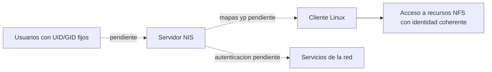

# Diagrama — NIS (autenticación centralizada)

> Servicio: **NIS** · puerto `111` (portmapper) + puertos RPC · IP pendiente de definir  
> **Estado: pendiente de implementar** — sin guía de instalación ni evidencias en `capturas/`.

**Flujo previsto**

1. El servidor NIS mantendrá el directorio centralizado de usuarios y grupos.
2. Los clientes Linux consultarán los mapas NIS por RPC (portmapper en el puerto 111).
3. La identidad obtenida debe coincidir con los UID/GID fijos usados por NFS para evitar desajustes de permisos.

**Criterio de éxito pendiente:** los clientes se autentican contra el servidor NIS (`ypwhich`, `getent passwd`).
