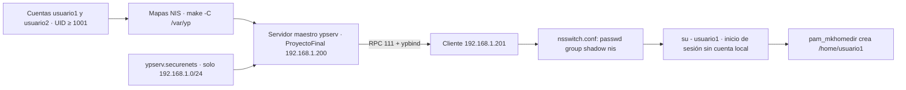

# Diagrama — NIS (autenticación centralizada)

> Servicio: **NIS** · dominio `empresa.local` · puerto `111` (rpcbind) + puertos RPC dinámicos · servidor `ProyectoFinal` (`192.168.1.200`)  
> Fuente: [`nis.md`](nis.md) · Red: [`../red/red.md`](../red/red.md) · Diagrama general: [`../../analisis.md`](../../analisis.md)

**Lectura del flujo**

1. Las cuentas se crean solo en el servidor; `MINUID=1001` evita publicar la cuenta local de administración (UID 1000).
2. `ypinit -m` y `make -C /var/yp` convierten `passwd`, `group` y `shadow` en mapas NIS del dominio `empresa.local`.
3. `ypserv.securenets` limita las consultas al propio servidor y a la red `192.168.1.0/24`.
4. El cliente se enlaza al servidor con `ypbind`, consulta NIS gracias a `nsswitch.conf` y crea el directorio personal en el primer inicio de sesión.

**Criterio de éxito (cumplido):** en el cliente, `ypwhich` responde `192.168.1.200`, `getent passwd usuario1` resuelve el usuario por NIS y `su - usuario1` abre sesión con la contraseña definida en el servidor.
