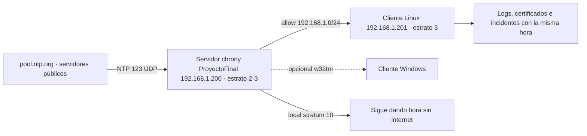

# Diagrama — NTP (sincronización horaria)

> Servicio: **NTP con chrony** · puerto `123/UDP` · servidor `ProyectoFinal` (`192.168.1.200`)  
> Fuente: [`ntp.md`](ntp.md) · Red: [`../red/red.md`](../red/red.md) · Diagrama general: [`../../analisis.md`](../../analisis.md)

**Lectura del flujo**

1. El servidor toma la hora de los servidores públicos de `pool.ntp.org` y de las fuentes por defecto de Ubuntu.
2. La directiva `allow 192.168.1.0/24` permite que los equipos de la red local le pidan la hora por el puerto 123/UDP.
3. El cliente usa como única fuente `server 192.168.1.200 iburst` y queda un estrato por debajo del servidor.
4. Si se pierde internet, `local stratum 10` hace que el servidor siga entregando su hora a la red.

**Criterio de éxito (cumplido):** en el cliente, `chronyc sources -v` muestra `^* proyectofinal.empresa.local` y la prueba de desajuste corrige la fecha de `2026-01-01` a la hora real.
