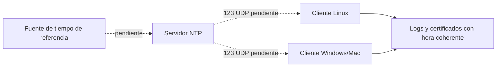

# Diagrama — NTP (sincronización horaria)

> Servicio: **NTP** · puerto `123/UDP` · IP pendiente de definir  
> **Estado: pendiente de implementar** — sin guía de instalación ni evidencias en `capturas/`.

**Flujo previsto**

1. El servidor NTP tomará el tiempo de una fuente de referencia y lo servirá a la red local.
2. Los clientes sincronizarán su reloj contra el servidor por el puerto 123/UDP.
3. Esto permitirá correlacionar logs, trazabilidad de incidentes y validez de certificados.

**Criterio de éxito pendiente:** los clientes sincronizan con el servidor (`timedatectl` / `chronyc sources`).
