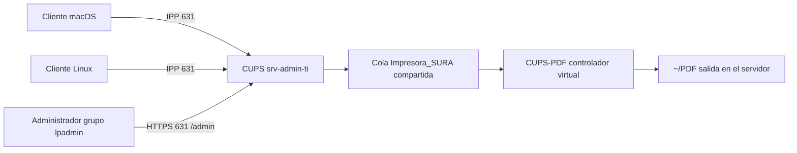

# Diagrama — CUPS (impresión centralizada)

> Servicio: **CUPS** · puerto `631` (IPP/HTTPS) · `${ip del servidor cups}`  
> Fuente: [`cups.md`](cups.md) · Diagrama general: [`../../analisis.md`](../../analisis.md)

**Lectura del flujo**

1. Los clientes descubren `Impresora_SURA` por Bonjour/IPP o la vinculan por la IP del servidor.
2. CUPS centraliza los controladores PPD y las colas; solo `lpadmin` puede administrarlos.
3. La cola virtual genera el documento PDF en `~/PDF/` del servidor, evitando drivers en cada estación.
4. El tráfico de administración va cifrado con TLS en el puerto 631.

**Criterio de éxito:** `lpstat -p -d` muestra la impresora activa y `lpq -a` los trabajos `completed`.
