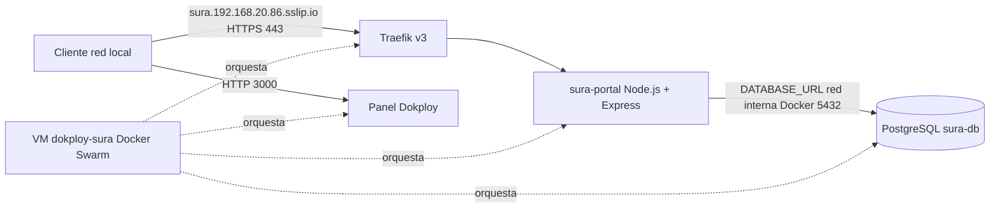

# Diagrama — Dokploy / Traefik / Web / Base de datos

> Servicio: **Dokploy (PaaS)** · `dokploy-sura` · `192.168.20.86`  
> Fuente: [`dokploy.md`](dokploy.md) · Diagrama general: [`../../analisis.md`](../../analisis.md)

**Lectura del flujo**

1. El cliente accede al portal por `https://sura.192.168.20.86.sslip.io` (puerto 443).
2. Traefik termina el TLS con el certificado autofirmado y enruta hacia el contenedor `sura-portal` en el puerto 3000.
3. El portal consulta y escribe en `sura-db` por la red interna de Docker; PostgreSQL no expone puertos a la LAN.
4. La administración se realiza en `http://192.168.20.86:3000`, donde Dokploy gestiona proyectos, dominios y despliegues.

**Criterio de éxito:** `/health` devuelve `{"status":"ok","db":"conectada"}` y el portal carga por HTTPS.
