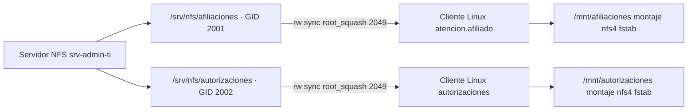

# Diagrama — NFS (volúmenes de Afiliaciones y Autorizaciones)

> Servicio: **NFS** · puerto `2049` · `${ip del servidor nfs}`  
> Fuente: [`nfs.md`](nfs.md) · Diagrama general: [`../../analisis.md`](../../analisis.md)

**Lectura del flujo**

1. El servidor exporta dos volúmenes con UID/GID fijos y permisos `770`.
2. Cada cliente crea los mismos usuarios y grupos para mantener la propiedad de los archivos.
3. El montaje se realiza por NFSv4 y se persiste en `/etc/fstab` con `_netdev` y `x-systemd.automount`.
4. `root_squash` impide que el `root` remoto tenga privilegios sobre los exportados.

**Criterio de éxito:** `df -h | grep nfs4` muestra el volumen montado y el usuario del rol puede escribir.
