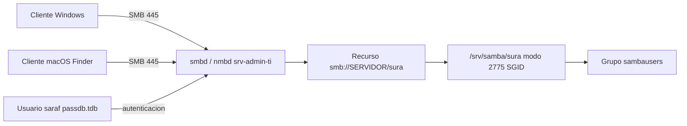

# Diagrama — Samba (recurso compartido `sura`)

> Servicio: **Samba SMB/CIFS** · puertos `139`, `445` (TCP) y `137`, `138` (UDP) · `<IP_SERVIDOR>`  
> Fuente: [`samba.md`](samba.md) · Diagrama general: [`../../analisis.md`](../../analisis.md)

**Lectura del flujo**

1. Los clientes Windows y macOS acceden a `smb://<IP_SERVIDOR>/sura` mediante SMB/CIFS.
2. Samba valida credenciales contra su base TDB, independiente de `/etc/shadow`.
3. El acceso está restringido a `@sambausers`.
4. El bit SGID (`2775`) hace que todo lo creado herede el grupo `sambausers`, con máscara `0664` para archivos y `0775` para directorios.

**Criterio de éxito:** `smbclient //localhost/sura -U saraf` abre el prompt `smb: \>` y permite lectura/escritura.
