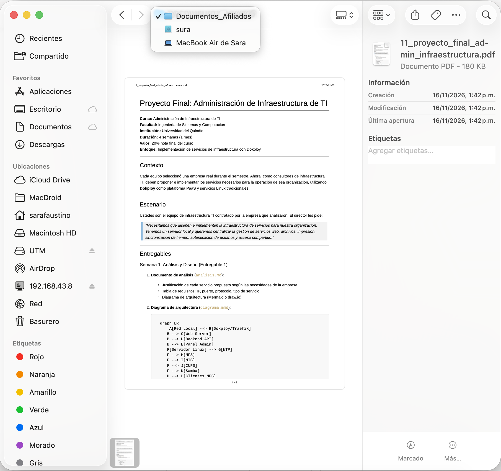
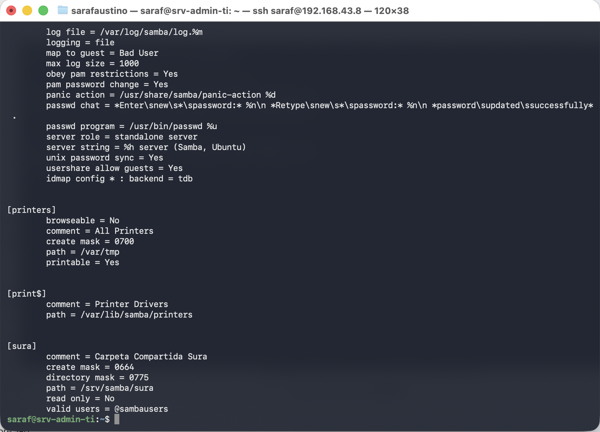
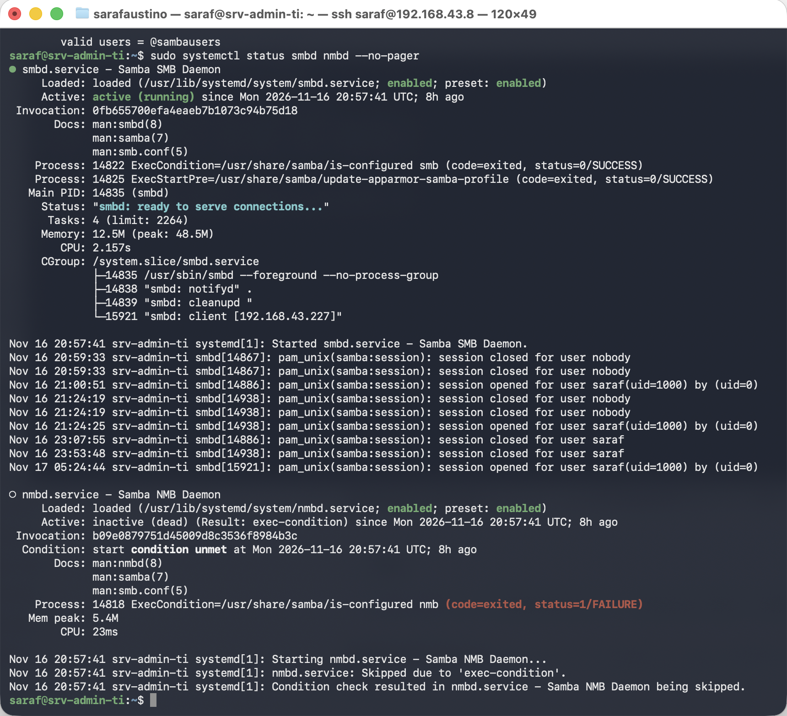
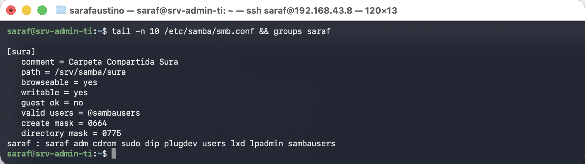

# Servicio de Compartición de Archivos (Samba)

> **Curso:** Administración de Infraestructura de TI  
> **Institución:** Universidad del Quindío — Facultad de Ingeniería de Sistemas y Computación  
> **Servidor:** Ubuntu Server 24.04 LTS (`srv-admin-ti`)  
> **Cliente de pruebas:** macOS (Apple Silicon M4)

---

## 1. Análisis y diseño

### 1.1 Justificación del servicio

La implementación del servicio Samba mediante el protocolo SMB/CIFS responde a la necesidad de disponer de un repositorio centralizado de almacenamiento de archivos en el directorio `/srv/samba/sura`. Este servicio proporciona compatibilidad e interoperabilidad nativa entre entornos de red heterogéneos, permitiendo el acceso concurrente y transparente desde clientes con sistemas operativos macOS y Microsoft Windows.

La arquitectura de seguridad y control de acceso se fundamenta en tres pilares principales:

- **Control de acceso granular:** Restricción del recurso exclusivo para usuarios pertenecientes al grupo del sistema `@sambausers`.
- **Base de credenciales independiente:** Uso de la base de datos de contraseñas TDB (`passdb.tdb`) de Samba, desacoplando la autenticación de red del archivo del sistema `/etc/shadow`.
- **Herencia de permisos colaborativos:** Configuración del bit SGID (`2775`) en el directorio base. Esto garantiza que todos los archivos y subdirectorios creados hereden automáticamente el grupo propietario `sambausers`, preservando la consistencia de los permisos colaborativos sin requerir intervención manual administrativa.

### 1.2 Tabla de requisitos de red

| Servicio | Protocolo | Puerto(s) | Tipo de servicio | Recurso / Ruta | Criterio de éxito |
|----------|-----------|-----------|------------------|----------------|-------------------|
| Samba (SMB/CIFS) | TCP / UDP | 139, 445 (TCP) · 137, 138 (UDP) | Compartición de archivos multiplataforma | `//<IP_SERVIDOR>/sura` (`/srv/samba/sura`) | Carpeta compartida accesible con permisos de lectura y escritura desde clientes macOS/Windows mediante credenciales válidas. |

---

## 2. Procedimiento de instalación y configuración

### 2.1 Entorno base

La plataforma sobre la cual se desplegó el servicio cumple con las siguientes especificaciones técnicas y parámetros de infraestructura:

| Parámetro | Valor |
|-----------|-------|
| Hipervisor | UTM (arquitectura ARM64 sobre Apple Silicon M4) |
| Sistema operativo | Ubuntu Server 24.04 LTS |
| Nombre de host | `srv-admin-ti` |
| Usuario administrador | `saraf` |
| Recursos asignados | 2 vCPUs, 4 GB de memoria RAM, 40 GB de disco virtual |
| Configuración de red | Interfaz en modo puente (Bridged), identificada como `enp0s1` |

### 2.2 Instalación y estructura de directorios con permisos

**Instalación de paquetes:** actualización de los repositorios del sistema e instalación del servidor Samba y el cliente CLI para pruebas locales.

```bash
sudo apt update && sudo apt install samba smbclient -y
```

**Gestión de grupos y usuarios:** creación del grupo dedicado para el servicio y vinculación del usuario de administración.

```bash
sudo groupadd sambausers
sudo usermod -aG sambausers saraf
```

**Creación del directorio del recurso:** preparación del punto de montaje local.

```bash
sudo mkdir -p /srv/samba/sura
```

**Asignación de propiedad y permisos POSIX/SGID:** establecimiento de `root:sambausers` como propietarios y aplicación del modo `2775` (SGID + `rwxrwxr-x`).

```bash
sudo chown -R root:sambausers /srv/samba/sura
sudo chmod -R 2775 /srv/samba/sura
```

### 2.3 Gestión de credenciales SMB

Debido al aislamiento entre las contraseñas del sistema Linux y la base TDB de Samba, se procedió a dar de alta y activar la cuenta del usuario en el servicio:

```bash
sudo smbpasswd -a saraf
sudo smbpasswd -e saraf
```

### 2.4 Configuración del recurso compartido (`/etc/samba/smb.conf`)

Respaldo de la configuración de fábrica:

```bash
sudo cp /etc/samba/smb.conf /etc/samba/smb.conf.bak
```

Edición del archivo de configuración: inclusión del bloque `[sura]` al final de `/etc/samba/smb.conf` (archivo de referencia: [`smb-sura.conf`](smb-sura.conf)):

```ini
[sura]
   comment = Carpeta Compartida Sura
   path = /srv/samba/sura
   browseable = yes
   writable = yes
   guest ok = no
   valid users = @sambausers
   create mask = 0664
   directory mask = 0775
```

Validación sintáctica y reinicio de servicios:

```bash
testparm -s
sudo systemctl enable --now smbd nmbd
sudo systemctl restart smbd nmbd
```

---

## 3. Comandos de verificación y pruebas

Para corroborar la correcta operatividad y disponibilidad del servicio, se ejecutaron los siguientes procedimientos de validación.

### 3.1 Estado de los servicios del sistema

Verificación del estado de ejecución de los demonios SMB (transferencia de archivos) y NMB (resolución de nombres NetBIOS):

```bash
sudo systemctl status smbd nmbd
```

**Criterio de aceptación:** `smbd` debe reportar el estado `active (running)`. `nmbd` solo se requiere para el descubrimiento por nombre NetBIOS; en la evidencia aparece omitido por systemd (ver problema 3) y el recurso funciona igual por IP.

### 3.2 Validación de la sintaxis de Samba

Confirmación de la lectura de parámetros sin errores en el archivo de configuración:

```bash
testparm -s
```

**Criterio de aceptación:** la salida del comando muestra la carga limpia de las directivas globales y la sección `[sura]`.

### 3.3 Prueba de conexión local mediante CLI

Conexión de prueba en el propio servidor para verificar la autenticación del usuario y la validez de los permisos de acceso:

```bash
smbclient //localhost/sura -U saraf
```

**Criterio de aceptación:** ingreso exitoso tras suministrar la contraseña del usuario `saraf`, desplegando el prompt interactivo `smb: \>`.

### 3.4 Prueba de integración desde cliente macOS

1. Abrir la aplicación Finder en la estación de trabajo macOS.
2. Presionar `Cmd + K` para abrir la ventana **Conectarse al servidor**.
3. Ingresar la URI del recurso: `smb://<IP_SERVIDOR>/sura`.
4. Autenticarse seleccionando **Usuario registrado** e introduciendo las credenciales del usuario `saraf`.
5. Probar la creación de carpetas y archivos desde el entorno gráfico.
6. Verificar desde la consola del servidor (`srv-admin-ti`) la aplicación de los permisos esperados (`0664` para archivos y `0775` para directorios).

---

## 4. Solución de problemas encontrados (troubleshooting)

Durante el proceso de despliegue y validación se identificaron las siguientes incidencias, junto a sus respectivas soluciones técnicas.

### Problema 1: Separación de autenticación entre el SO Linux y Samba

- **Síntoma:** rechazo de autenticación (`Access Denied`) al intentar conectar clientes remotos o locales, a pesar de usar un usuario existente en el sistema operativo.
- **Causa raíz:** Samba no consulta el archivo `/etc/shadow` por defecto para validar contraseñas de red, sino que mantiene una base de datos local cifrada (`passdb.tdb`).
- **Resolución:** registrar e inicializar formalmente la cuenta dentro del esquema de Samba mediante `sudo smbpasswd -a saraf` para definir la clave y `sudo smbpasswd -e saraf` para habilitar el usuario.

### Problema 2: Aislamiento de red local en el cliente macOS (`ERR_ADDRESS_UNREACHABLE`)

- **Síntoma:** error de conexión por tiempo de espera o dirección inalcanzable al intentar mapear `smb://<IP_SERVIDOR>/sura` desde macOS.
- **Causa raíz:** restricciones de privacidad introducidas en macOS para acceso a la red local por parte de aplicaciones del sistema, o falta de enrutamiento adecuado cuando la máquina anfitriona utiliza conexiones compartidas (ej. tethering móvil).
- **Resolución:**
  1. Habilitar explícitamente los permisos de red en **Ajustes del Sistema > Privacidad y seguridad > Red local**.
  2. Verificar la conectividad mediante `ping <IP_SERVIDOR>` desde la Terminal de macOS.
  3. Comprobar la visibilidad de los puertos requeridos usando `nc -zv <IP_SERVIDOR> 445`.

### Problema 3: `nmbd` aparece como `inactive (dead)`

- **Síntoma:** `systemctl status smbd nmbd` muestra `smbd` activo y `nmbd` en `inactive (dead)` con `start condition unmet`.
- **Causa raíz:** el script de Ubuntu `/usr/share/samba/is-configured nmb` indicó que NetBIOS no está configurado, por lo que systemd omitió `nmbd`.
- **Resolución:** no se requiere acción para este recurso: los clientes se conectan por IP al puerto 445, que atiende `smbd`. `nmbd` solo haría falta para ver el servidor por nombre NetBIOS en el "Entorno de red" de Windows.

---

## 5. Evidencias para el repositorio Git

### Carpeta `capturas/samba/`

| Archivo | Contenido |
|---------|-----------|
| `01_samba_finder_mac.png` | Finder de macOS conectado al recurso `sura` del servidor, con los archivos creados durante las pruebas de escritura. |
| `02_samba_permisos_servidor.png` | Salida de `testparm -s` en el servidor con las directivas globales y la sección `[sura]`. |
| `03_samba_servicios_activos.png` | `sudo systemctl status smbd nmbd`: `smbd` activo y sesiones abiertas por `saraf` desde el cliente `192.168.43.227`. |
| `04_samba_configuracion_final.png` | Bloque `[sura]` final de `/etc/samba/smb.conf` y grupos de `saraf` (incluye `sambausers` y `lpadmin`). |









### Carpeta `codigo/samba/`

| Archivo | Contenido |
|---------|-----------|
| `smb-sura.conf` | Bloque `[sura]` agregado al final de `/etc/samba/smb.conf`. |
| `diagrama-samba.md` | Diagrama del flujo de acceso al recurso compartido. |
