# Documentación técnica de infraestructura TI — SURA EPS

> **Documentación técnica — Entregable 4 (Semana 4)**  
> **Empresa:** SURA EPS (caso de estudio académico)  
> **Área:** Tecnología de la Información / Infraestructura y Operaciones  
> **Versión:** 1.0 · **Estado:** Vigente

Este documento reúne los procedimientos de instalación, los comandos de verificación, las capturas de pantalla y la solución de problemas de cada servicio desplegado. El análisis de diseño y la tabla de requisitos se encuentran en [`analisis.md`](analisis.md).

---

## 1. Entorno base y convenciones

| Elemento | Valor |
|----------|-------|
| Sistema operativo | Ubuntu Server 24.04 LTS |
| Recursos mínimos | 2 vCPU · 4 GB RAM · 40 GB de disco |
| Hipervisor (Dokploy) | VMware Workstation Pro 26H1u1 · VM `dokploy-sura` |
| Hipervisor (servicios Linux) | UTM (ARM64 sobre Apple Silicon M4) · host `srv-admin-ti` |
| Red | Modo puente (Bridged), IP fija vía netplan |
| IP del entorno Dokploy | `192.168.20.86/24` · gateway `192.168.20.1` |
| Usuarios administradores | `derek` (VM Dokploy) · `saraf` (servicios Linux) |

**Convención de placeholders.** Los comandos siguientes son normativos y no deben modificarse. Los marcadores se reemplazan por los valores reales antes de ejecutar: `${ip del servidor nfs}`, `${ip del usuario}`, `${ip del servidor cups}` y `<IP_SERVIDOR>`. La IP `192.168.20.86` corresponde al laboratorio de pruebas.

**Regla de gobernanza.** Los bloques de código son normativos (tal como aparecen en las guías de `codigo/`); solo se amplía la documentación explicativa a su alrededor.

---

## 2. Infraestructura base: VM, IP fija y Dokploy

Fuente: [`codigo/dokploy/dokploy.md`](codigo/dokploy/dokploy.md).

### 2.1 Creación de la máquina virtual

Se creó la VM `dokploy-sura` con la ISO `ubuntu-24.04.5-live-server-amd64.iso` y 2 vCPU / 4 GB RAM / 40 GB de disco.

| Pantalla del instalador | Opción elegida | Motivo |
|-------------------------|----------------|--------|
| Tipo de instalación | Ubuntu Server (estándar) | Incluye herramientas básicas de administración |
| Red | DHCP en `ens33` | Se fija la IP después de instalar |
| Almacenamiento | Disco completo, **sin LVM** | Con LVM el instalador usa solo la mitad del disco; Docker necesita el espacio completo |
| Perfil | Usuario `derek`, servidor `dokploy-sura` | — |
| Ubuntu Pro | Omitido | No necesario para el proyecto |
| SSH | **OpenSSH Server instalado** | Permite administración remota |
| Snaps | Ninguno | Docker lo instala Dokploy |

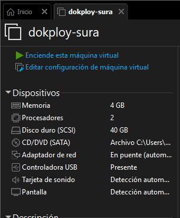

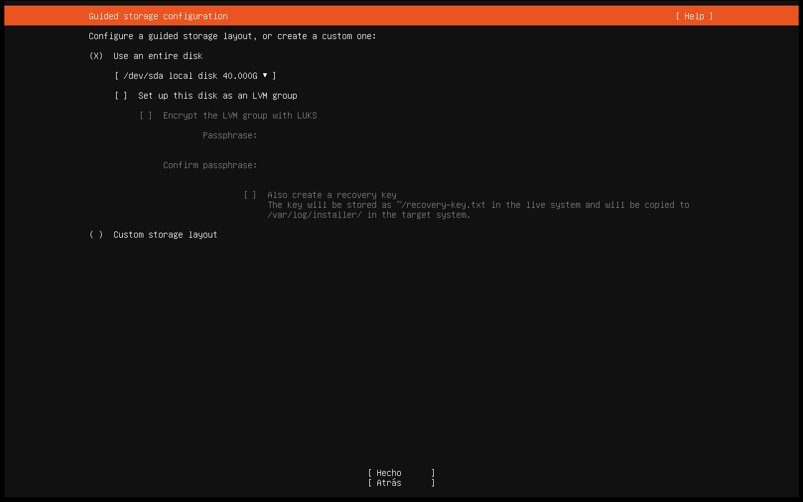

### 2.2 Verificación de IP y acceso por SSH

```bash
## En el servidor: ver las interfaces de red y la IP asignada
ip a
```

```powershell
## Desde Windows (PowerShell): conexión remota al servidor
ssh derek@192.168.20.86
```

### 2.3 Actualización del sistema

```bash
sudo apt update && sudo apt upgrade -y

## Muestra la tabla de rutas para identificar la puerta de enlace (default via)
ip route
```

### 2.4 Configuración de IP fija con netplan

Dokploy y los dominios apuntan a la IP del servidor, por lo que esta no puede cambiar.

```bash
## Evita que cloud-init vuelva a escribir la red en cada arranque
echo "network: {config: disabled}" | sudo tee /etc/cloud/cloud.cfg.d/99-disable-network-config.cfg

## Respalda la configuración DHCP original
sudo mv /etc/netplan/50-cloud-init.yaml /etc/netplan/50-cloud-init.yaml.bak
```

Contenido de `/etc/netplan/01-ip-fija.yaml`:

```yaml
network:
  version: 2
  ethernets:
    ens33:
      dhcp4: false
      addresses:
        - 192.168.20.86/24
      routes:
        - to: default
          via: 192.168.20.1
      nameservers:
        addresses: [192.168.20.1, 8.8.8.8, 1.1.1.1]
```

```bash
## Permisos 600: netplan exige que solo root pueda leer el archivo
sudo chmod 600 /etc/netplan/01-ip-fija.yaml

## Aplica la nueva configuración de red
sudo netplan apply

## Verificación: archivo, IP sin "dynamic" y salida a internet
sudo cat /etc/netplan/01-ip-fija.yaml && ip a show ens33 && ping -c 3 google.com
```

**Resultado esperado:** `inet 192.168.20.86/24` con `valid_lft forever` (ya no aparece `dynamic`) y `3 received, 0% packet loss`.


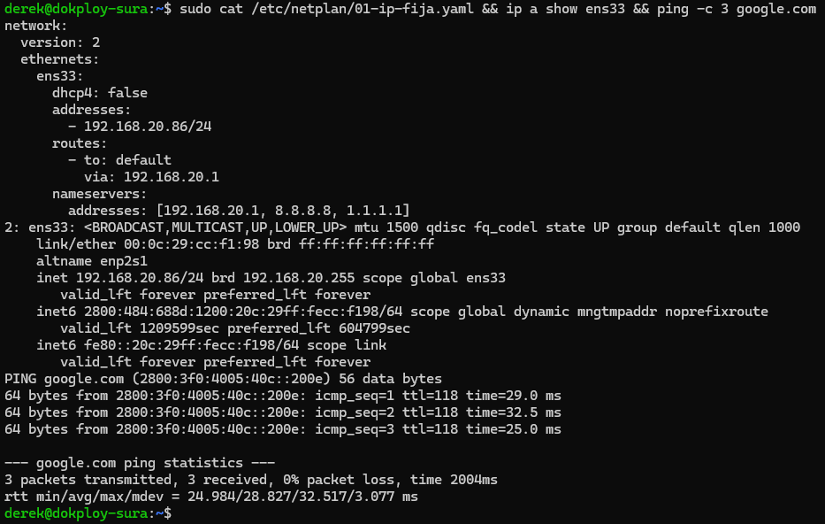

### 2.5 Instalación de Dokploy

```bash
## Instala Docker, inicializa Swarm y despliega Dokploy, Traefik, PostgreSQL y Redis internos
## ADVERTISE_ADDR indica la IP por la que Swarm anuncia el nodo
curl -sSL https://dokploy.com/install.sh | sudo ADVERTISE_ADDR=192.168.20.86 sh
```

El instalador termina con `Congratulations, Dokploy is installed!`. El token de `docker swarm join` se difuminó en la captura porque permitiría unir otros equipos al clúster.

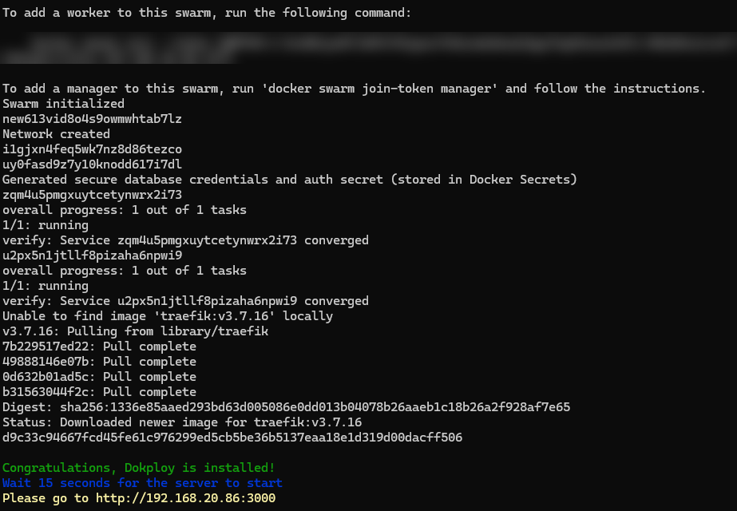

Luego se abre `http://192.168.20.86:3000`, se registra la cuenta de administrador y se verifica el acceso al panel.


**Componentes en funcionamiento:**

| Componente | Función |
|------------|---------|
| Docker + Docker Swarm | Ejecuta las aplicaciones como servicios en contenedores |
| Traefik v3 | Proxy inverso: enruta dominios y gestiona certificados HTTPS |
| PostgreSQL y Redis internos | Datos y colas del propio Dokploy |
| Panel web (puerto 3000) | Administración de proyectos, aplicaciones, bases de datos y dominios |

### 2.6 Solución de problemas

| Problema | Causa | Solución |
|----------|-------|----------|
| `ens33 — autoconfiguration failed`, sin IP (captura P1a) | El puente de VMware estaba en "Automático" y se conectó al adaptador virtual de Hyper-V, no a la tarjeta física | En **Edit → Virtual Network Editor → VMnet0** cambiar *Bridged to* a **Realtek PCIe GbE Family Controller** (captura P1b) y volver a pedir IP con *Edit IPv4 → Automatic (DHCP)* |
| `cat: /etc/netplan/01-ip-fija.yaml: Permission denied` | El archivo tiene permisos `600` (solo root) | Leerlo con `sudo cat`. Este error confirma que los permisos quedaron correctos |
| En *Domains* aparece en rojo "Domain resolves to 192.168.20.86 but should point to…" | Dokploy compara el dominio con la IP pública del router; el servidor es local y el dominio apunta a propósito a su IP privada | No requiere acción: el portal funciona en la LAN. En producción el dominio apuntaría a una IP pública |
| El navegador muestra "No es seguro" | Certificado autofirmado de Traefik (ver §4.3) | Aceptar en *Configuración avanzada → Continuar*. En producción se usaría Let's Encrypt |

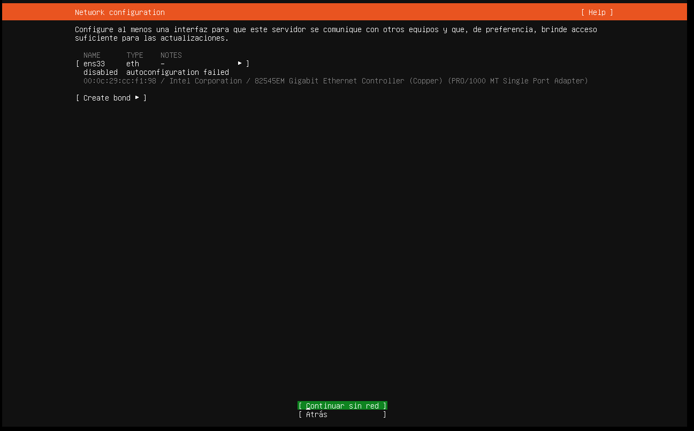


---

## 3. Base de datos PostgreSQL

Fuente: [`codigo/dokploy/dokploy.md`](codigo/dokploy/dokploy.md), parte 4.

Desde el panel se creó el proyecto **SURA EPS** y, dentro de él, el servicio de base de datos:

| Campo | Valor |
|-------|-------|
| Nombre | `sura-db` |
| Motor e imagen | PostgreSQL · `postgres:16` |
| Base de datos | `sura` |
| Usuario | `sura_app` |
| Contraseña | Definida en el panel (no se documenta) |
| Acceso | Solo por la red interna de Docker; ningún puerto expuesto hacia la LAN |

Se presionó **Deploy** y el log terminó con `Deployment completed successfully!`. Dokploy muestra la *Internal Connection URL* con el formato `postgresql://sura_app:********@<nombre-interno>:5432/sura`, que es la que usa la aplicación.

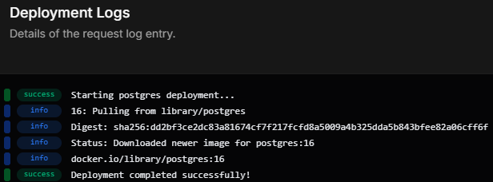

**Verificación:** el endpoint `/health` del portal devuelve `{"status":"ok","db":"conectada"}`.

---

## 4. Servicio Web y HTTPS

Fuente: [`codigo/dokploy/dokploy.md`](codigo/dokploy/dokploy.md), partes 5 y 6; [`codigo/dokploy/app/README.md`](codigo/dokploy/app/README.md).

### 4.1 Aplicación `sura-portal`

Portal en **Node.js + Express** que muestra el estado del despliegue, lee sedes y servicios desde PostgreSQL, registra incidentes de TI y expone `/health`. Crea sus tablas y datos de prueba automáticamente al iniciar.

| Ruta | Descripción |
|------|-------------|
| `/` | Portal web |
| `/health` | Estado de la app y de la conexión a la BD |
| `/api/estado` | Contenedor, versión de Node y de PostgreSQL |
| `/api/sedes`, `/api/servicios` | Datos de ejemplo en PostgreSQL |
| `GET/POST /api/incidentes` | Registro de incidentes (sin datos personales) |

Configuración en Dokploy:

| Campo | Valor |
|-------|-------|
| Provider | Git |
| Repository URL | `https://github.com/optitudes/sura_admin_ti.git` |
| Branch | `main` |
| Build Path | `/codigo/dokploy/app` |
| Build Type | Dockerfile |

Variables de entorno (pestaña *Environment*):

```text
DATABASE_URL=postgresql://sura_app:********@<nombre-interno-de-sura-db>:5432/sura
PORT=3000
```

```dockerfile
FROM node:22-alpine
WORKDIR /app
COPY package*.json ./
RUN npm install --omit=dev
COPY . .
ENV PORT=3000
EXPOSE 3000
HEALTHCHECK --interval=30s --timeout=5s CMD wget -qO- http://localhost:3000/health || exit 1
CMD ["node", "server.js"]
```

Al presionar **Deploy**, Dokploy clonó el repositorio, construyó la imagen y levantó el contenedor. Los logs confirman:

```text
Base de datos lista
Portal SURA EPS (académico) escuchando en puerto 3000
```


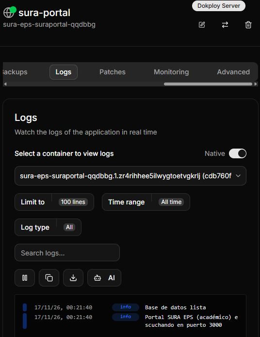

### 4.2 Dominio y certificado

En la pestaña **Domains** de `sura-portal`:

| Campo | Valor |
|-------|-------|
| Host | `sura.192.168.20.86.sslip.io` |
| Path | `/` |
| Container Port | `3000` |
| HTTPS | Activado |
| Certificate Provider | None (certificado propio de Traefik) |

**¿Por qué sslip.io?** Servicio DNS gratuito que resuelve cualquier nombre con una IP incrustada hacia esa IP, sin comprar un dominio ni configurar un DNS propio.

**¿Por qué autofirmado?** El servidor tiene IP privada, así que Let's Encrypt no puede validarlo desde internet. Traefik genera su propio certificado (*TRAEFIK DEFAULT CERT*, válido por un año). La conexión va cifrada con TLS, pero el navegador muestra "No es seguro". En producción con IP pública se cambiaría *Certificate Provider* a **Let's Encrypt** sin modificar nada más.

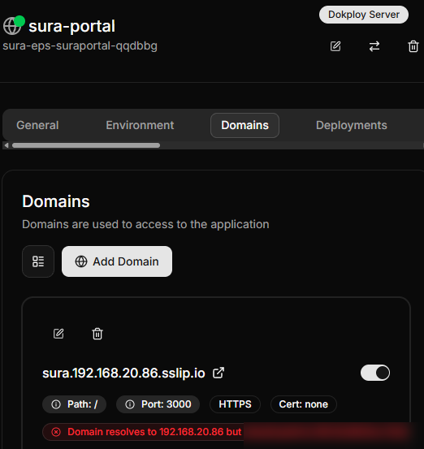


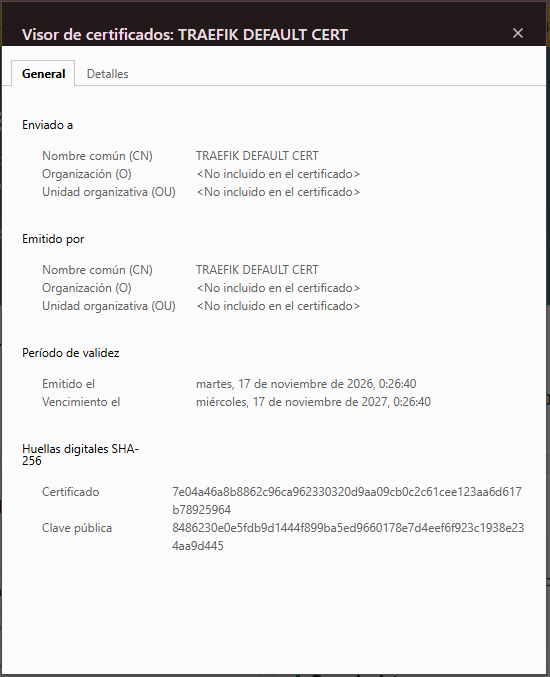

### 4.3 Verificación del servicio Web

| Prueba | Resultado | Captura |
|--------|-----------|---------|
| Panel de Dokploy accesible en `:3000` | Correcto | `20_dokploy_panel_projects.png` |
| Base de datos `sura-db` desplegada | `Deployment completed successfully!` | `22_postgres_sura-db_desplegado.png` |
| Construcción de imagen | `Docker build completed` | `23_build_app_sura-portal_exitoso.png` |
| Conexión app → PostgreSQL | `Base de datos lista` en logs | `24_logs_app_conectada_bd.png` |
| Acceso por dominio con HTTPS | Portal cargado con "Base de datos conectada" | `26_portal_https_bd_conectada.png` |
| Lectura desde BD | Tablas de sedes y servicios cargadas | `26_portal_https_bd_conectada.png` |
| Escritura en BD | Incidente registrado y listado | `27_registro_incidente_escritura_bd.png` |
| Certificado TLS | Emitido por `TRAEFIK DEFAULT CERT` | `28_certificado_traefik_autofirmado.png` |

```bash
## -k acepta el certificado autofirmado
curl -k https://sura.192.168.20.86.sslip.io/health
## Respuesta esperada: {"status":"ok","db":"conectada"}
```

---

## 5. NFS — volúmenes compartidos

Fuente: [`codigo/nfs/nfs.md`](codigo/nfs/nfs.md).

### 5.1 Instalación y configuración del servidor

```bash
## Actualiza la lista de paquetes desde los repositorios de Debian
sudo apt update

## Instala el servidor NFS del kernel
sudo apt install -y nfs-kernel-server

## Crea los grupos con GID fijo
sudo groupadd -g 2001 grp_afiliaciones
sudo groupadd -g 2002 grp_autorizaciones

## Crea los usuarios con UID fijo
sudo useradd -m -u 2001 -g grp_afiliaciones -c "Atencion al Afiliado" atencion.afiliado
sudo useradd -m -u 2002 -g grp_autorizaciones -c "Autorizaciones y Servicios Medicos" autorizaciones

## Crea las carpetas que se van a compartir
sudo mkdir -p /srv/nfs/afiliaciones /srv/nfs/autorizaciones

## Asigna dueño y grupo a cada carpeta
sudo chown atencion.afiliado:grp_afiliaciones /srv/nfs/afiliaciones
sudo chown autorizaciones:grp_autorizaciones /srv/nfs/autorizaciones

## Permisos 770: solo dueño y grupo acceden
sudo chmod 770 /srv/nfs/afiliaciones /srv/nfs/autorizaciones

## Verifica dueños y permisos
ls -ld /srv/nfs/afiliaciones /srv/nfs/autorizaciones
```

Contenido de `/etc/exports` (reemplazar `${ip del usuario}` por la IP real del cliente):

```text
## Configuracion del /etc/exports
/srv/nfs/afiliaciones     ${ip del usuario}(rw,sync,no_subtree_check,root_squash)
/srv/nfs/autorizaciones   ${ip del usuario}(rw,sync,no_subtree_check,root_squash)
```

| Opción | Significado |
|--------|-------------|
| `rw` | Lectura y escritura habilitadas |
| `sync` | Confirma escritura en disco antes de responder (integridad) |
| `no_subtree_check` | Evita problemas al renombrar o mover archivos en el volumen |
| `root_squash` | Mapea `root` remoto a `nobody`/`nogroup` por seguridad |

```bash
## Aplica la configuración de exportaciones
sudo exportfs -ra

## Muestra lo que se está exportando
sudo exportfs -v

## Inicia NFS ahora y en cada arranque
sudo systemctl enable --now nfs-server

## Verifica que el servicio está activo
sudo systemctl status nfs-server
```

### 5.2 Configuración del cliente

```bash
## Instala el cliente NFS
sudo apt update && sudo apt install -y nfs-common

## Crea el mismo grupo y usuario (mismo GID/UID que en el servidor)
sudo groupadd -g 2001 grp_afiliaciones
sudo useradd -m -u 2001 -g grp_afiliaciones -c "Atencion al Afiliado" atencion.afiliado

## Crea el punto de montaje
sudo mkdir -p /mnt/afiliaciones

## Prueba de conectividad con el servidor
ping -c 3 ${ip del servidor nfs}

## Monta la carpeta del servidor usando su IP
sudo mount -t nfs4 ${ip del servidor nfs}:/srv/nfs/afiliaciones /mnt/afiliaciones

## Prueba de escritura como el usuario del rol
sudo -u atencion.afiliado touch /mnt/afiliaciones/prueba.txt
ls -l /mnt/afiliaciones/prueba.txt
```

> Repetir el procedimiento con GID/UID `2002` y el usuario `autorizaciones` para el otro volumen.

Montaje permanente en `/etc/fstab` (reemplazar `192.168.1.6` por la IP real):

```text
192.168.1.6:/srv/nfs/afiliaciones  /mnt/afiliaciones  nfs4  defaults,_netdev,x-systemd.automount,noatime  0  0
```

| Opción | Significado |
|--------|-------------|
| `_netdev` | El FS depende de la red; se monta tras la disponibilidad de red |
| `x-systemd.automount` | Monta bajo demanda al acceder, evitando demoras en el arranque |
| `noatime` | No actualiza la hora de último acceso (rendimiento) |
| `0 0` | Sin volcado (`dump`) ni chequeo (`fsck`) |

```bash
sudo systemctl daemon-reload
sudo mount -a
```

### 5.3 Comandos de verificación

```bash
## Desde el cliente
df -h | grep nfs4
mount | grep nfs4
showmount -e ${ip del servidor nfs}

## Desde el servidor
sudo exportfs -v
sudo systemctl status nfs-server
```

### 5.4 Solución de problemas

| Problema | Posible causa | Acción recomendada |
|----------|---------------|--------------------|
| `Permission denied` al montar | IP no autorizada en `/etc/exports` o falta `exportfs -ra` | Revisar `/etc/exports`, ejecutar `sudo exportfs -ra` y verificar con `sudo exportfs -v` |
| `Permission denied` al escribir | UID/GID no coinciden o permisos `770` restrictivos | Confirmar mismo UID/GID en cliente y servidor y `chmod 770` |
| Montaje colgado | Servidor no responde o falta `_netdev` | Agregar `_netdev` y `x-systemd.automount`; revisar con `ping` |
| Archivos como `nobody:nogroup` | `root_squash` activo o UID/GID no coinciden | Ajustar UID/GID; `no_root_squash` solo con aprobación de seguridad |
| `mount.nfs: Connection timed out` | Firewall bloqueando 2049 o servidor apagado | Verificar `ping`, estado de `nfs-server` y firewall |

### 5.5 Evidencias


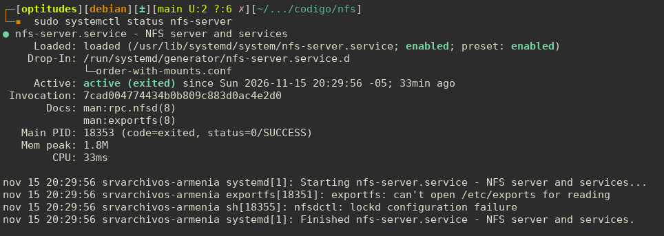

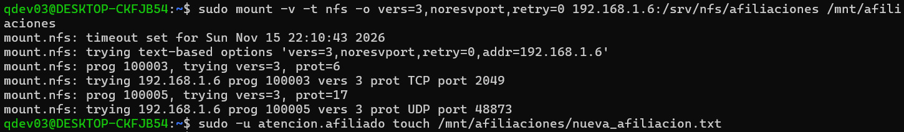

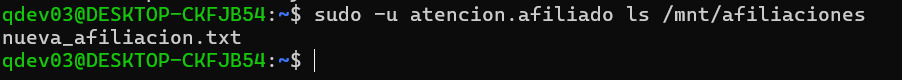


---

## 6. CUPS — servidor de impresión

Fuente: [`codigo/cups/cups.md`](codigo/cups/cups.md).

### 6.1 Instalación y configuración del servidor

```bash
## Habilita el repositorio universe y actualiza la lista de paquetes
sudo add-apt-repository universe -y
sudo apt update

## Instala el demonio CUPS y el controlador virtual PDF
sudo apt install -y cups printer-driver-cups-pdf

## Agrega el usuario administrador al grupo lpadmin
sudo usermod -aG lpadmin saraf
```

Accesso remoto en `/etc/cups/cupsd.conf`:

```bash
## Respalda la configuración original de CUPS
sudo cp /etc/cups/cupsd.conf /etc/cups/cupsd.conf.bak

## Permite acceso remoto, administración externa y compartición de impresoras
sudo cupsctl --remote-admin --remote-any --share-printers

## Agrega ServerAlias * para permitir peticiones HTTP/HTTPS por dirección IP
sudo sed -i '/^Port 631/a ServerAlias *' /etc/cups/cupsd.conf
```

Directivas clave: `Port 631` / `Listen 0.0.0.0:631` (escucha en todas las interfaces), `ServerAlias *` (evita el bloqueo por cabecera Host en CUPS 2.4+) y `Allow all` / `Allow @LOCAL` en `<Location />`, `<Location /admin>` y `<Location /admin/conf>`.

```bash
## Inicia CUPS ahora y lo habilita en cada arranque del sistema
sudo systemctl enable --now cups
sudo systemctl restart cups

## Verifica que el servicio CUPS está activo
sudo systemctl status cups
```

**Alta de la impresora (consola web):**

1. Acceder a `https://${ip del servidor cups}:631/admin` y aceptar el certificado autofirmado; iniciar sesión con `saraf`.
2. **Add Printer** → elegir **CUPS-PDF (Virtual PDF Printer)** → **Continue**.
3. Nombre `Impresora_SURA`, marcar **Share This Printer** y continuar.
4. Marca **Generic**, modelo **Generic CUPS-PDF Printer (w/ options)** → **Add Printer**.

### 6.2 Vinculación desde el cliente

```bash
## Prueba de conectividad ICMP hacia el servidor CUPS
ping -c 3 ${ip del servidor cups}

## Verifica que el puerto 631 (IPP/HTTPS) esté abierto
nc -zv ${ip del servidor cups} 631
```

Criterios: `ping` con 0% de pérdida y `Connection to ${ip del servidor cups} port 631 [tcp/ipp] succeeded!`.

**macOS:** habilitar *Red local* en *Ajustes del Sistema → Privacidad y seguridad*, luego *Impresoras y escáneres → Agregar impresora* y seleccionar `Impresora_SURA` detectada por Bonjour/IPP (o por IP con protocolo IPP y cola `printers/Impresora_SURA`).

**Prueba de impresión:** abrir un documento, `Cmd + P`, seleccionar `Impresora_SURA` y verificar el PDF generado en `~/PDF/` del servidor.

### 6.3 Verificación

```bash
## Estado de la impresora y impresora por defecto
lpstat -p -d

## Estado de la cola activa
lpq -a

## PDFs generados por la cola
ls -la ~/PDF/
```

También se puede revisar `https://${ip del servidor cups}:631/jobs?which_jobs=completed`: los trabajos deben aparecer como `completed`.

### 6.4 Solución de problemas

| Problema | Posible causa | Acción recomendada |
|----------|---------------|--------------------|
| `Package 'cups-pdf' has no installation candidate` | Paquete renombrado en 24.04 o `universe` deshabilitado | `sudo add-apt-repository universe -y && sudo apt update` e instalar `printer-driver-cups-pdf` |
| `403 Forbidden` en `/admin` | Validación estricta de cabecera Host en CUPS 2.4+ | Agregar `ServerAlias *` bajo `Port 631` y `sudo systemctl restart cups` |
| `ERR_ADDRESS_UNREACHABLE` desde macOS | Permiso de Red local desactivado o AP Isolation | Activar Red local y validar con `ping` |
| Trabajos en `stopped` o `held` | PPD incompatible o impresora pausada | Usar *Generic CUPS-PDF Printer (w/ options)* y `sudo cupsenable Impresora_SURA` |

### 6.5 Evidencias

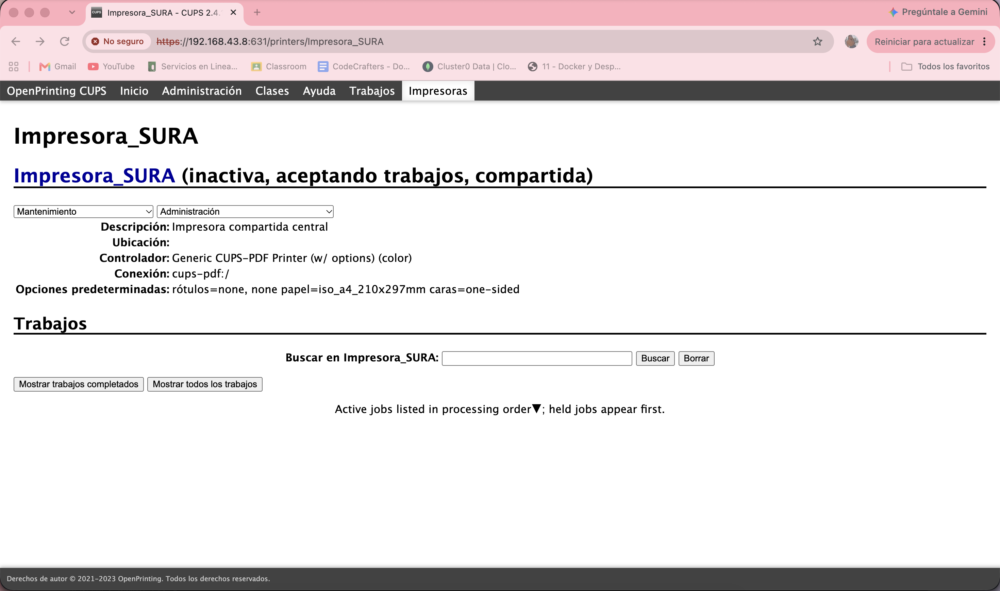


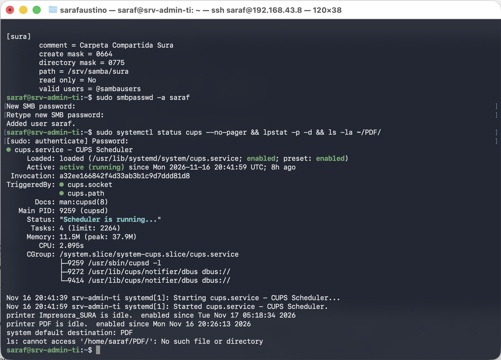


---

## 7. Samba — compartición multiplataforma

Fuente: [`codigo/samba/samba.md`](codigo/samba/samba.md).

### 7.1 Instalación, usuarios y permisos

```bash
sudo apt update && sudo apt install samba smbclient -y

sudo groupadd sambausers
sudo usermod -aG sambausers saraf

sudo mkdir -p /srv/samba/sura

sudo chown -R root:sambausers /srv/samba/sura
sudo chmod -R 2775 /srv/samba/sura
```

El modo **2775** aplica el bit SGID: todos los archivos y subdirectorios creados heredan el grupo `sambausers`, preservando la consistencia de permisos sin intervención manual.

### 7.2 Credenciales SMB

Samba no consulta `/etc/shadow`, sino su base cifrada `passdb.tdb`:

```bash
sudo smbpasswd -a saraf
sudo smbpasswd -e saraf
```

### 7.3 Configuración del recurso compartido

```bash
sudo cp /etc/samba/smb.conf /etc/samba/smb.conf.bak
```

Agregar al final de `/etc/samba/smb.conf`:

```ini
[sura]
   comment = Carpeta Compartida Sura
   path = /srv/samba/sura
   browseable = yes
   writable = yes
   guest ok = no
   valid users = @sambausers
   create mask = 0664
   directory mask = 0775
```

```bash
testparm -s
sudo systemctl enable --now smbd nmbd
sudo systemctl restart smbd nmbd
```

### 7.4 Verificación y pruebas

```bash
## Estado de los demonios SMB y NMB
sudo systemctl status smbd nmbd

## Validación sintáctica
testparm -s

## Conexión local por CLI
smbclient //localhost/sura -U saraf
```

Criterios: ambos servicios en `active (running)`; `testparm -s` carga sin errores las directivas globales y la sección `[sura]`; `smbclient` muestra el prompt `smb: \>`.

**Desde macOS (Finder):**

1. `Cmd + K` para abrir *Conectarse al servidor*.
2. URI: `smb://<IP_SERVIDOR>/sura`.
3. Autenticarse con *Usuario registrado* y las credenciales de `saraf`.
4. Crear carpetas y archivos; verificar en el servidor los permisos `0664` y `0775`.

### 7.5 Solución de problemas

| Problema | Causa | Solución |
|----------|-------|----------|
| `Access Denied` con usuario existente en el SO | Samba usa `passdb.tdb`, no `/etc/shadow` | `sudo smbpasswd -a saraf` y `sudo smbpasswd -e saraf` |
| `ERR_ADDRESS_UNREACHABLE` desde macOS (timeout al mapear) | Permisos de Red local o tethering móvil sin enrutamiento | Activar Red local, `ping <IP_SERVIDOR>` y `nc -zv <IP_SERVIDOR> 445` |

### 7.6 Evidencias


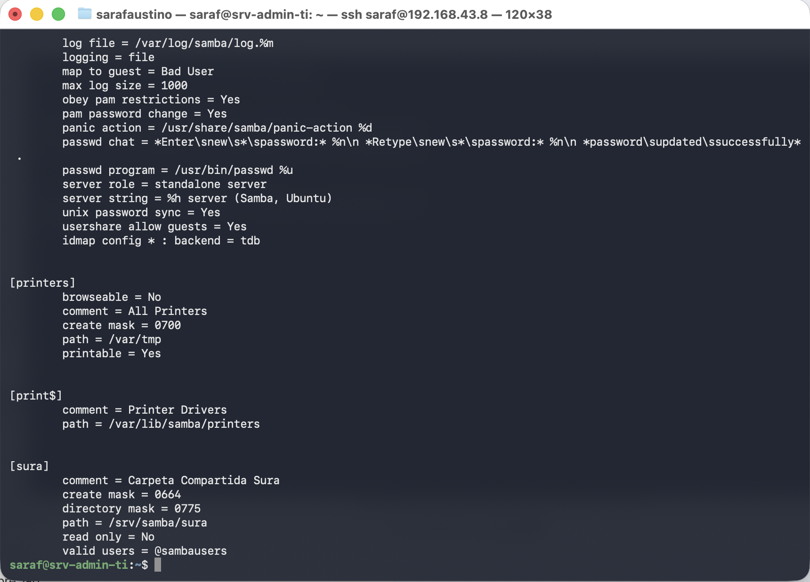


---

## 8. NTP — sincronización horaria

> ### ⚠️ PENDIENTE DE IMPLEMENTAR
>
> El servicio NTP forma parte del diseño aprobado (ver `analisis.md`, §2.4 y §3, fila 5) y es necesario para la correlación de logs y la trazabilidad de incidentes. Sin embargo, **el equipo aún no cuenta con una guía de instalación ni con evidencias en `capturas/`**, por lo que no se documentan procedimientos ni comandos de verificación.
>
> **Puerto previsto:** 123/UDP. **Criterio de éxito pendiente:** los clientes de la red sincronizan su reloj con el servidor.

Diagrama previsto: [`codigo/Ntp/diagrama-ntp.md`](codigo/Ntp/diagrama-ntp.md).

---

## 9. NIS — autenticación centralizada

> ### ⚠️ PENDIENTE DE IMPLEMENTAR
>
> El servicio NIS también forma parte del diseño (ver `analisis.md`, §2.6 y §3, fila 7) para centralizar las cuentas de usuario de las estaciones Linux y mantener la coherencia con los UID/GID definidos para NFS. **No existe guía de instalación ni evidencia de pantalla**, por lo que se documenta únicamente su estado.
>
> **Puerto previsto:** 111 (portmapper) y puertos RPC dinámicos. **Criterio de éxito pendiente:** los clientes se autentican contra el servidor NIS.

Diagrama previsto: [`codigo/Nis/diagrama-nis.md`](codigo/Nis/diagrama-nis.md).

---

## 10. Matriz de verificación y criterios de éxito

| # | Servicio | Comando / prueba principal | Resultado esperado | Estado |
|---|----------|----------------------------|--------------------|--------|
| 1 | Web | `curl -k https://sura.192.168.20.86.sslip.io/health` | `{"status":"ok","db":"conectada"}` | ✅ |
| 2 | NTP | `timedatectl` en cliente | Sincronizado con el servidor | ⏳ Pendiente |
| 3 | NFS | `df -h \| grep nfs4` en cliente | Volumen `/mnt/afiliaciones` montado | ✅ |
| 4 | NIS | `ypwhich` / `getent passwd` en cliente | Usuarios del mapa NIS disponibles | ⏳ Pendiente |
| 5 | CUPS | `lpstat -p -d` / `lpq -a` | `Impresora_SURA` activa, trabajos `completed` | ✅ |
| 6 | Samba | `smbclient //localhost/sura -U saraf` | Prompt `smb: \>` y escritura permitida | ✅ |
| 7 | Base de datos | Logs de `sura-portal` | `Base de datos lista` | ✅ |

**Leyenda:** ✅ implementado y verificado · ⏳ pendiente de implementar.

---

## 11. Anexo — inventario de evidencias

| Servicio | Ruta | Capturas |
|----------|------|----------|
| Dokploy / infraestructura base | `capturas/dokploy/` | `01`–`28` (VM, instalación, IP fija, panel, BD, build, logs, dominio, portal, certificado), `P1a`, `P1b` (problemas) |
| NFS | `capturas/nfs/` | `01` exportaciones, `02` servicio en servidor, `03` montaje en cliente, `04` creación de documento, `05` validación en servidor |
| CUPS | `capturas/cups/` | `01` impresora activa, `02` trabajo completado, `03` terminal del servidor, `04` configuración final |
| Samba | `capturas/samba/` | `01` Finder macOS, `02` permisos, `03` servicios activos, `04` configuración final |
| NTP | `capturas/ntp/` | Sin evidencias (pendiente) |
| NIS | `capturas/nis/` | Sin evidencias (pendiente) |

**Notas de seguridad aplicadas en todo el despliegue:** contraseñas distintas para Ubuntu, panel de Dokploy y base de datos (ninguna aparece en documentos ni capturas); PostgreSQL sin puertos expuestos a la LAN; `DATABASE_URL` almacenada solo en variables de entorno; consultas parametrizadas y escapado de HTML en la app; token de Swarm, correo de administrador e IP pública del router difuminados en las capturas.
